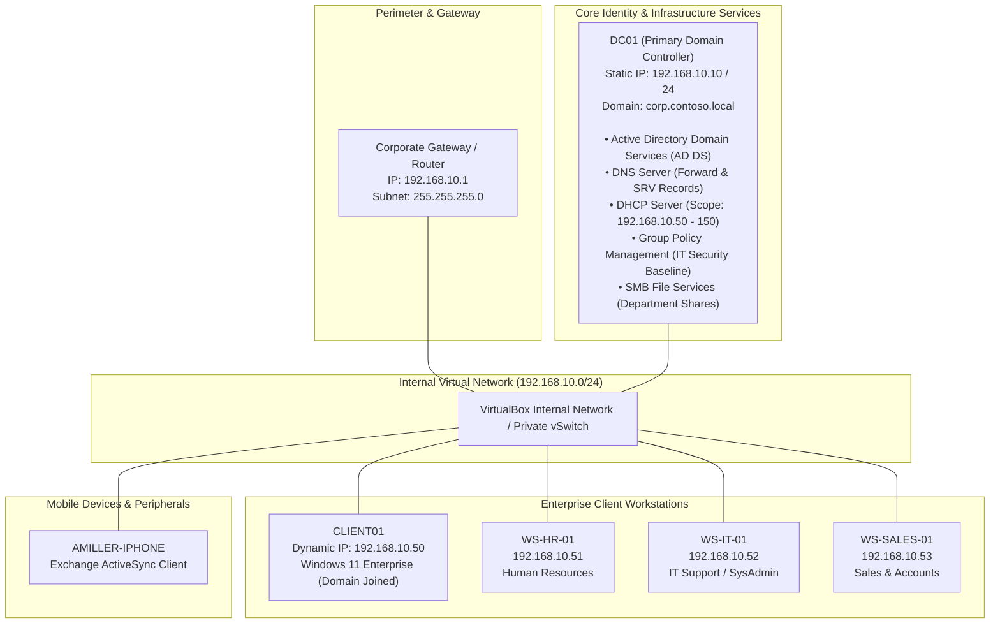
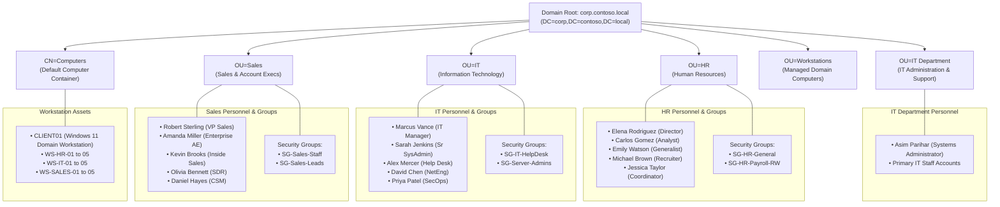
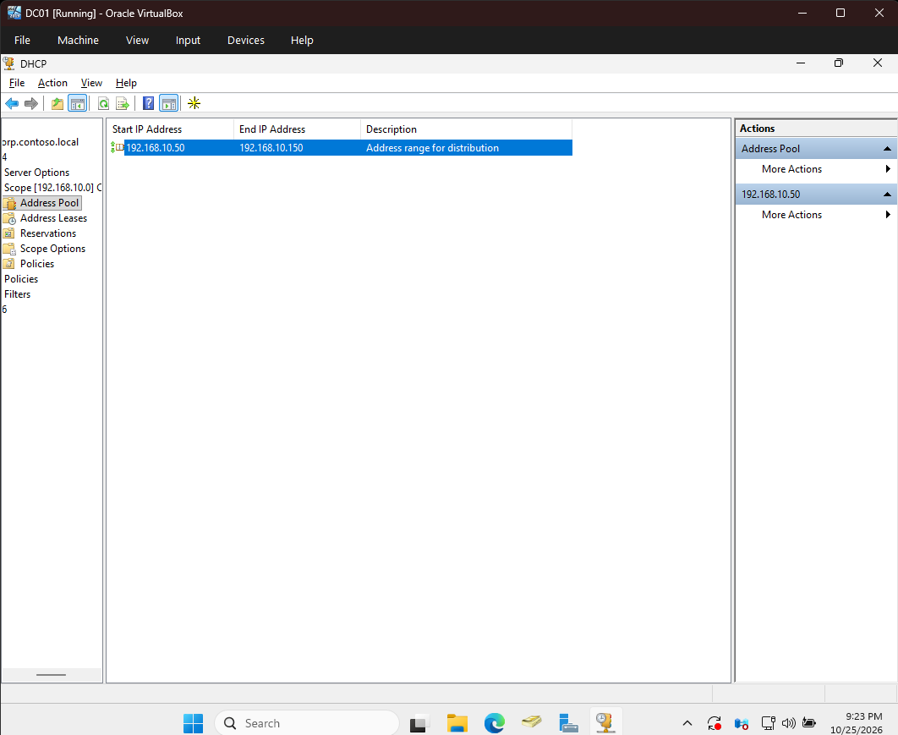
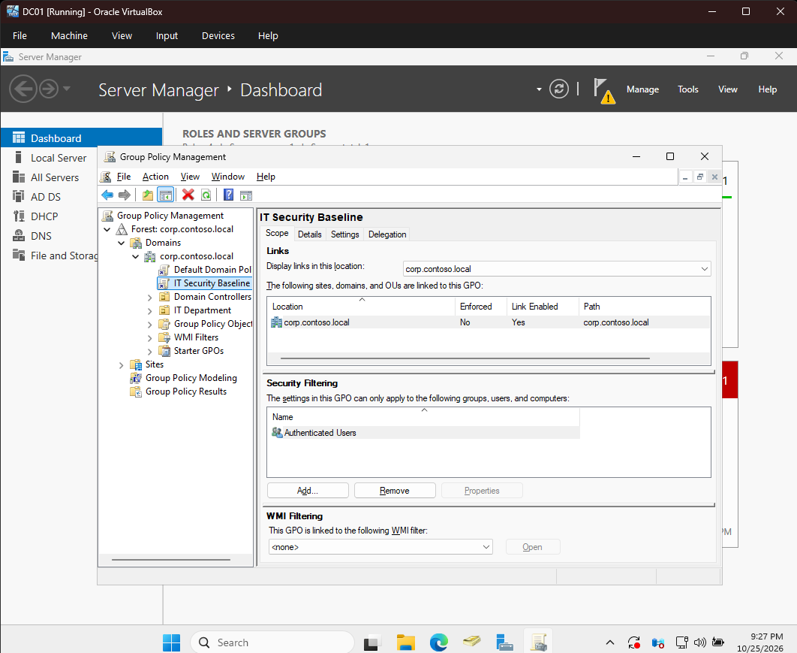
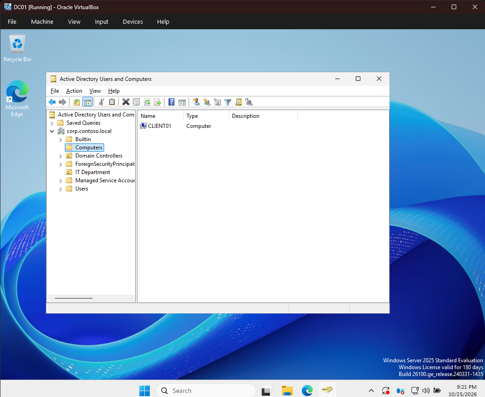
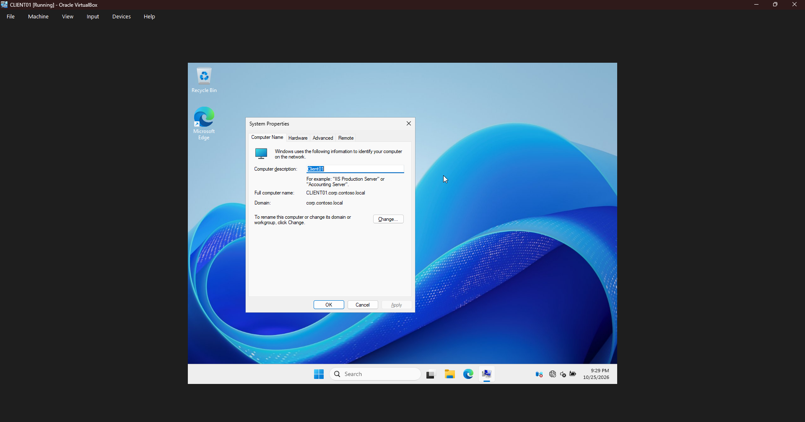
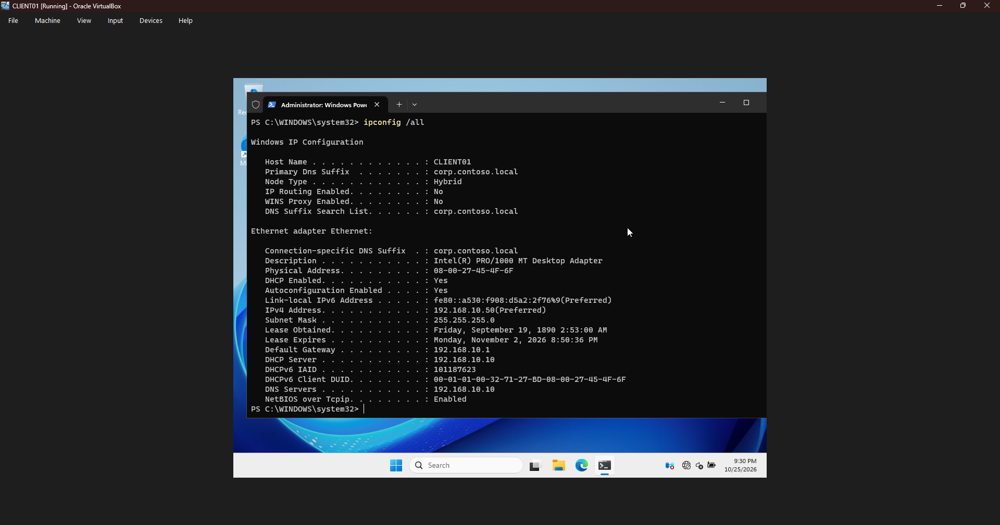
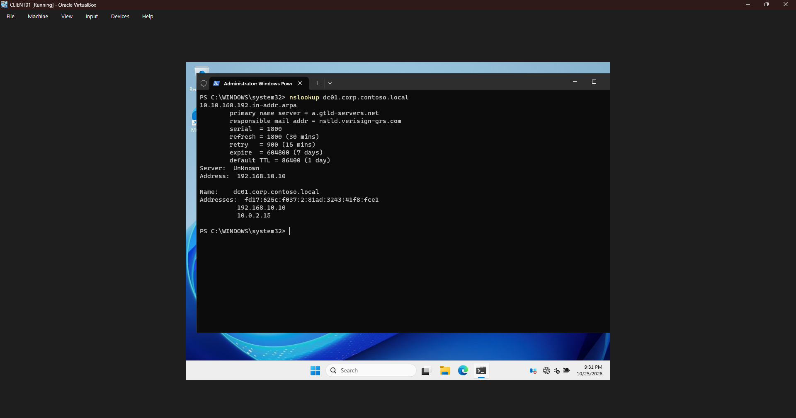
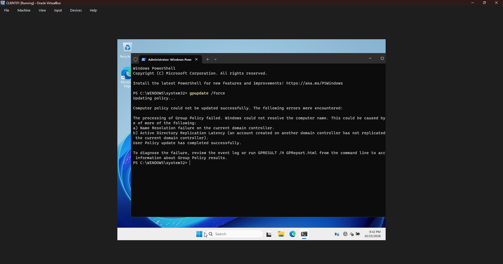

# Enterprise Active Directory & Help Desk Simulation Lab


An end-to-end enterprise Active Directory infrastructure and technical support portfolio lab. This repository showcases automated domain provisioning with PowerShell, organizational unit (OU) design, bulk user lifecycle management, group policy hardening, network service validation (DNS & DHCP), and real-world Help Desk incident response case studies supported by verified visual evidence.

---

## Table of Contents
- [1. Infrastructure & Network Topology](#1-infrastructure--network-topology)
- [2. Active Directory Logical Hierarchy](#2-active-directory-logical-hierarchy)
- [3. Repository Structure](#3-repository-structure)
- [4. Visual Evidence & Screenshot Catalog](#4-visual-evidence--screenshot-catalog)
- [5. PowerShell Automation Scripts](#5-powershell-automation-scripts)
  - [Script 01: Setup AD DS, DNS, and DHCP](#script-01-setup-ad-ds-dns-and-dhcp)
  - [Script 02: Bulk OU & User Provisioning](#script-02-bulk-ou--user-provisioning)
  - [Dataset: 16 Realistic Employee Records](#dataset-16-realistic-employee-records)
- [6. Group Policy Architecture](#6-group-policy-architecture)
- [7. Help Desk Incident Case Studies](#7-help-desk-incident-case-studies)
- [8. Lab Setup & Deployment Guide](#8-lab-setup--deployment-guide)
- [9. Core Competencies & Skills Demonstrated](#9-core-competencies--skills-demonstrated)

---

## 1. Infrastructure & Network Topology

The lab operates on an isolated enterprise virtual network (`192.168.10.0/24`) hosted on Oracle VirtualBox / Hyper-V, anchored by a Windows Server Primary Domain Controller (`DC01`) providing centralized identity, internal DNS resolution, and automated DHCP IP leasing.



### Network Configuration Matrix

| Device / Component | Hostname | IPv4 Address | Subnet Mask | Gateway | DNS 1 | Roles / Functions |
| :--- | :--- | :--- | :--- | :--- | :--- | :--- |
| **Default Gateway** | `Edge-Gateway` | `192.168.10.1` | `255.255.255.0` | N/A | External | Router / NAT |
| **Domain Controller** | `DC01` | `192.168.10.10` | `255.255.255.0` | `192.168.10.1` | `127.0.0.1` | AD DS, DNS, DHCP, GPO, File Server |
| **DHCP Client Pool** | Dynamic | `192.168.10.50 - 150` | `255.255.255.0` | `192.168.10.1` | `192.168.10.10` | Leased to Workstations & Laptops |
| **Domain Workstation** | `CLIENT01` | `192.168.10.50` (Leased) | `255.255.255.0` | `192.168.10.1` | `192.168.10.10` | Windows 11 Enterprise (Verified Client) |
| **HR Client** | `WS-HR-01` | `192.168.10.51` | `255.255.255.0` | `192.168.10.1` | `192.168.10.10` | Windows 11 Enterprise |
| **IT Client** | `WS-IT-01` | `192.168.10.52` | `255.255.255.0` | `192.168.10.1` | `192.168.10.10` | Windows 11 Enterprise / RSAT Tools |
| **Sales Client** | `WS-SALES-01` | `192.168.10.53` | `255.255.255.0` | `192.168.10.1` | `192.168.10.10` | Windows 11 Enterprise |

---

## 2. Active Directory Logical Hierarchy

The domain follows standard corporate segregation principles, organizing objects by department and purpose to allow scoped delegation of control and targeted Group Policy application.



---

## 3. Repository Structure

All repository directories and files follow standardized lowercase kebab-case naming conventions:

```
Active-Directory-HelpDesk-Lab/
│
├── architecture/
│   └── README.md                                 # Network specs, subnet scheme, port matrix
│
├── group-policy/
│   └── README.md                                 # GPO baselines (IT Security Baseline, Password)
│
├── helpdesk-tickets/
│   ├── ticket-001-account-lockout.md             # P2: Stale mobile credentials & Event 4740
│   ├── ticket-002-shared-folder-permission-denied.md # P3: AGDLP group access & Kerberos token purge
│   └── ticket-003-workstation-domain-join-failure.md # P3: Public DNS vs internal AD SRV record
│
├── powershell-scripts/
│   ├── 01-setup-ad-dns-dhcp.ps1                 # Automated DC, DNS, and DHCP installer
│   ├── 02-create-users.ps1                      # OU generation & CSV bulk user provisioning
│   └── users.csv                                # 16 realistic employee records
│
├── screenshots/
│   ├── README.md                                 # Visual evidence catalog & screenshots gallery
│   ├── client01-dns-nslookup.png                 # Forward DNS resolution proof on CLIENT01
│   ├── client01-domain-join-properties.png       # Domain join verification in System Properties
│   ├── client01-gpupdate-force.png               # Group Policy refresh verification
│   ├── client01-ipconfig-dhcp-lease.png          # DHCP dynamic lease proof (192.168.10.50)
│   ├── dc01-ad-user-creation-details.png         # ADUC new user creation wizard
│   ├── dc01-ad-user-creation-password.png        # Mandatory password reset configuration
│   ├── dc01-ad-user-creation-summary.png         # User provisioning summary dialog
│   ├── dc01-aduc-computers-client01.png          # CLIENT01 computer account in ADUC
│   ├── dc01-aduc-it-department-user.png          # Asim Parihar user object in IT Department OU
│   ├── dc01-aduc-user-properties.png             # User account properties dialog
│   ├── dc01-dhcp-scope-address-pool.png          # DHCP Scope 192.168.10.50 - 150 address pool
│   └── dc01-gpo-it-security-baseline.png         # IT Security Baseline GPO linked to domain
│
└── README.md                                     # Root project documentation & portfolio guide
```

---

## 4. Visual Evidence & Screenshot Catalog

Verified console captures directly substantiate the deployment and configuration:

| Component | Evidence Capture | Preview |
| :--- | :--- | :--- |
| **DHCP Address Pool** | Active scope `192.168.10.0` address pool (`192.168.10.50 - 150`) on `DC01` | [](screenshots/dc01-dhcp-scope-address-pool.png) |
| **Group Policy Baseline** | `IT Security Baseline` GPO linked to `corp.contoso.local` | [](screenshots/dc01-gpo-it-security-baseline.png) |
| **Domain Computer Join** | `CLIENT01` registered in ADUC under `corp.contoso.local\Computers` | [](screenshots/dc01-aduc-computers-client01.png) |
| **Workstation Domain Status** | `CLIENT01.corp.contoso.local` verified in Windows System Properties | [](screenshots/client01-domain-join-properties.png) |
| **Client DHCP Lease** | `ipconfig /all` on `CLIENT01` with IP `192.168.10.50` & DNS `192.168.10.10` | [](screenshots/client01-ipconfig-dhcp-lease.png) |
| **Client DNS Resolution** | `nslookup dc01.corp.contoso.local` resolving to `192.168.10.10` | [](screenshots/client01-dns-nslookup.png) |
| **User Provisioning** | User `Asim Parihar` (`asimp`) created in `OU=IT Department` | [](screenshots/dc01-aduc-it-department-user.png) |
| **GPO Client Enforcement** | `gpupdate /force` executing policy refresh on `CLIENT01` | [](screenshots/client01-gpupdate-force.png) |

*Explore the full screenshot walkthrough in [`screenshots/README.md`](screenshots/README.md).*

---

## 5. PowerShell Automation Scripts

### Script 01: Setup AD DS, DNS, and DHCP
**File**: [`powershell-scripts/01-setup-ad-dns-dhcp.ps1`](powershell-scripts/01-setup-ad-dns-dhcp.ps1)

Transforms a clean Windows Server install into an enterprise domain controller through an intelligent two-phase execution:

* **Phase 1 (Pre-Reboot)**:
  * Performs administrative elevation verification.
  * Configures static IPv4 address (`192.168.10.10/24`), gateway (`192.168.10.1`), and loopback DNS (`127.0.0.1`).
  * Installs Windows Features: `AD-Domain-Services`, `DNS`, `DHCP`, and RSAT tools.
  * Deploys new Active Directory Forest for `corp.contoso.local` via `Install-ADDSForest`.
  * Triggers automated reboot.
* **Phase 2 (Post-Reboot)**:
  * Detects Domain Controller status (`Win32_ComputerSystem.DomainRole >= 4`).
  * Authorizes the DHCP server in Active Directory (`Add-DhcpServerInDC`).
  * Creates IPv4 DHCP Scope `Corporate-LAN` (`192.168.10.50 - 192.168.10.150`).
  * Configures DHCP Scope Options:
    * **Option 003**: Router (`192.168.10.1`)
    * **Option 006**: DNS Server (`192.168.10.10`)
    * **Option 015**: DNS Domain Name (`corp.contoso.local`)
  * Activates scope, restarts services, and prints a formatted diagnostic report.

```powershell
# Usage: Run in an Administrator PowerShell console
Set-ExecutionPolicy RemoteSigned -Scope Process
.\powershell-scripts\01-setup-ad-dns-dhcp.ps1
```

---

### Script 02: Bulk OU & User Provisioning
**File**: [`powershell-scripts/02-create-users.ps1`](powershell-scripts/02-create-users.ps1)

Automates the directory organizational structure and imports staff accounts from a CSV file:

* **OU Deployment**:
  * Creates `OU=HR`, `OU=IT`, `OU=Sales`, `OU=IT Department`, and `OU=Workstations` under domain root.
  * Enables `-ProtectedFromAccidentalDeletion $true` to prevent inadvertent admin removal.
* **User Provisioning**:
  * Validates CSV headers and schema.
  * Generates consistent naming conventions:
    * `UserPrincipalName`: `<username>@corp.contoso.local`
    * `SamAccountName`: `<username>`
  * Assigns secure temporary password (`ContosoTemp2026!`).
  * Enforces `-ChangePasswordAtLogon $true` (compliance best practice).
  * Automatically maps users into their departmental OU based on the `Department` column.
  * Logs real-time status and produces a color-coded reconciliation summary.

```powershell
# Usage:
.\powershell-scripts\02-create-users.ps1 -CSVPath ".\powershell-scripts\users.csv"
```

---

### Dataset: 16 Realistic Employee Records
**File**: [`powershell-scripts/users.csv`](powershell-scripts/users.csv)

| First Name | Last Name | Username | Department | Job Title | Email Address |
| :--- | :--- | :--- | :--- | :--- | :--- |
| **Marcus** | Vance | `mvance` | IT | IT Manager | `mvance@corp.contoso.local` |
| **Sarah** | Jenkins | `sjenkins` | IT | Senior Systems Administrator | `sjenkins@corp.contoso.local` |
| **Alex** | Mercer | `amercer` | IT | Help Desk Specialist | `amercer@corp.contoso.local` |
| **David** | Chen | `dchen` | IT | Network Engineer | `dchen@corp.contoso.local` |
| **Priya** | Patel | `ppatel` | IT | Cybersecurity Analyst | `ppatel@corp.contoso.local` |
| **Asim** | Parihar | `asimp` | IT | Systems Administrator | `asimp@corp.contoso.local` |
| **Elena** | Rodriguez | `erodriguez` | HR | Director of Human Resources | `erodriguez@corp.contoso.local` |
| **Michael** | Brown | `mbrown` | HR | Senior Talent Acquisition Specialist | `mbrown@corp.contoso.local` |
| **Emily** | Watson | `ewatson` | HR | HR Generalist | `ewatson@corp.contoso.local` |
| **Carlos** | Gomez | `cgomez` | HR | Compensation & Benefits Analyst | `cgomez@corp.contoso.local` |
| **Jessica** | Taylor | `jtaylor` | HR | HR Operations Coordinator | `jtaylor@corp.contoso.local` |
| **Robert** | Sterling | `rsterling` | Sales | VP of Global Sales | `rsterling@corp.contoso.local` |
| **Amanda** | Miller | `amiller` | Sales | Enterprise Account Executive | `amiller@corp.contoso.local` |
| **Kevin** | Brooks | `kbrooks` | Sales | Inside Sales Representative | `kbrooks@corp.contoso.local` |
| **Olivia** | Bennett | `obennett` | Sales | Sales Development Representative | `obennett@corp.contoso.local` |
| **Daniel** | Hayes | `dhayes` | Sales | Customer Success Manager | `dhayes@corp.contoso.local` |

---

## 6. Group Policy Architecture

The environment enforces corporate baseline security through linked GPOs managed on `DC01`:

1. **Default Domain Password Policy**:
   * Minimum password length: **12 characters**.
   * Complexity enabled (Upper, Lower, Digits, Symbols).
   * Account Lockout Threshold: **5 invalid logon attempts** within a 30-minute observation window.
   * Lockout Duration: **30 minutes** (or administrative manual unlock).
2. **IT Security Baseline GPO (Linked to `corp.contoso.local`)**:
   * Screen saver lock enforced after **15 minutes (900 seconds)** of inactivity.
   * Standard user elevation prompts require administrator credentials.
   * Removable USB storage write restrictions enabled (DLP policy).
3. **Departmental Network Drive Mappings via GPP**:
   * `H:` Personal Home Drive mapped to `\\DC01\Home$\%USERNAME%`.
   * `S:` Shared Departmental Drive mapped to `\\DC01\Shares\<Department>` via Item-Level Targeting (ILT).

*See full implementation documentation in [`group-policy/README.md`](group-policy/README.md).*

---

## 7. Help Desk Incident Case Studies

Real-world scenarios documented in complete ITSM ticketing format:

### [Ticket HD-2026-0104: Account Lockout & ActiveSync Loop](helpdesk-tickets/ticket-001-account-lockout.md)
* **Symptom**: Enterprise Account Executive locked out of her workstation three times in one morning following a routine password update.
* **Triage & Diagnosis**: Domain Controller Security Event Log inspection on `DC01` revealed repeated **Event ID 4740** generated by caller computer `AMILLER-IPHONE`.
* **Root Cause**: Stale corporate credentials cached inside mobile Outlook app repeatedly failing ActiveSync authentication every 60 seconds.
* **Resolution**: Isolated device via Airplane Mode, executed `Unlock-ADAccount`, updated mobile Exchange credentials, verified zero bad logon attempts.

### [Ticket HD-2026-0118: Shared Folder Permission Denied](helpdesk-tickets/ticket-002-shared-folder-permission-denied.md)
* **Symptom**: Newly transferred HR Analyst unable to open `\\DC01\HR-Shares\Confidential-Payroll`.
* **Triage & Diagnosis**: Checked `Get-ADPrincipalGroupMembership`. User was missing required security group `SG-HR-Payroll-RW`.
* **Root Cause**: AGDLP role-based access control violation; department-level group had read access to parent folder, but subfolder inheritance was disabled.
* **Resolution**: Obtained HR Director approval, added user to `SG-HR-Payroll-RW`, executed `klist purge` to refresh Kerberos Ticket Granting Service (TGS) token without user reboot, verified read/modify permissions.

### [Ticket HD-2026-0129: Workstation Domain Join Failure](helpdesk-tickets/ticket-003-workstation-domain-join-failure.md)
* **Symptom**: Staging technician unable to join client workstation `CLIENT01` to `corp.contoso.local` ("AD DC could not be contacted").
* **Triage & Diagnosis**: Ping to server IP succeeded, but `nslookup -type=SRV _ldap._tcp.dc._msdcs.corp.contoso.local` failed with non-existent domain error.
* **Root Cause**: Client NIC had been statically configured with public DNS (`8.8.8.8`) during OS installation rather than internal AD DNS (`192.168.10.10`).
* **Resolution**: Enabled DHCP on NIC (`Option 006`), confirmed successful resolution of LDAP SRV record and `dc01.corp.contoso.local`, joined workstation `CLIENT01` to domain, verified via `Get-ADComputer`.

---

## 8. Lab Setup & Deployment Guide

To replicate this environment in **Oracle VirtualBox**, **Hyper-V**, or **VMware**:

```
Step 1: Hypervisor Configuration
        ├── Create Virtual Switch: "Internal-CorpLAN" (Private / Isolated Network)
        ├── Deploy VM 1: Windows Server (Hostname: DC01, 4GB RAM)
        └── Deploy VM 2: Windows 11 Enterprise (Hostname: CLIENT01, 4GB RAM)

Step 2: Server Automation (DC01)
        ├── Attach "Internal-CorpLAN" network adapter to DC01
        ├── Clone this repository to C:\Active-Directory-HelpDesk-Lab
        ├── Open PowerShell as Administrator
        ├── Execute .\powershell-scripts\01-setup-ad-dns-dhcp.ps1
        └── (Server will automatically reboot and promote to Domain Controller)

Step 3: Post-Reboot DHCP & User Provisioning
        ├── Log in as CORP\Administrator
        ├── Run .\powershell-scripts\01-setup-ad-dns-dhcp.ps1 (Phase 2 runs automatically)
        └── Run .\powershell-scripts\02-create-users.ps1

Step 4: Client Verification (CLIENT01)
        ├── Connect client VM to "Internal-CorpLAN"
        ├── Verify IP dynamically received via DHCP (192.168.10.50 - 150)
        ├── Verify DNS points to DC01: nslookup dc01.corp.contoso.local
        ├── Join client to domain "corp.contoso.local"
        └── Log in with created user credentials (e.g., asimp / ContosoTemp2026!)
```

---

## 9. Core Competencies & Skills Demonstrated

- **Directory Services**: Active Directory Domain Services (AD DS) design, Forest/Domain promotion, OU structuring, and delegation of control.
- **PowerShell Scripting & Automation**: Cmdlet-based systems administration, parameterized scripting, error handling (`try/catch`), and CSV object manipulation.
- **Core Enterprise Networking**: Static IP configuration, IPv4 subnetting (`/24`), DHCP scope architecture (`192.168.10.50 - 150`), DHCP Options (003, 006, 015), and AD DHCP authorization.
- **Name Resolution & DNS**: DNS SRV records (`_ldap._tcp.dc._msdcs`), forward lookup zones, dynamic DNS updates, and name resolution troubleshooting via `nslookup`.
- **Identity & Access Management (IAM)**: AGDLP role-based access model, Kerberos ticket lifecycle (`klist`), and password/lockout policy enforcement.
- **Incident Management & Technical Support**: Event Viewer log forensics (Event IDs 4740, 4625), network diagnostic utilities (`ipconfig`, `Test-NetConnection`), and structured RCA documentation.
