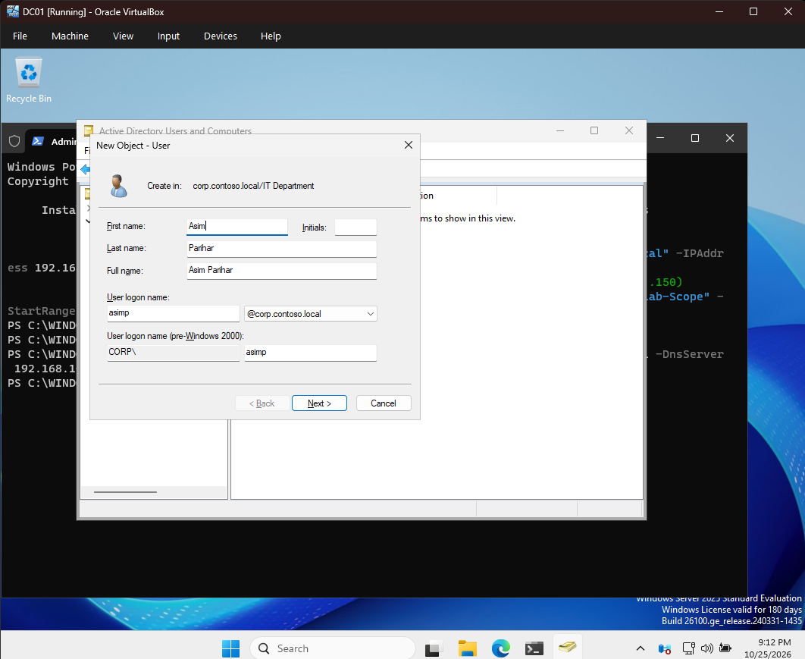
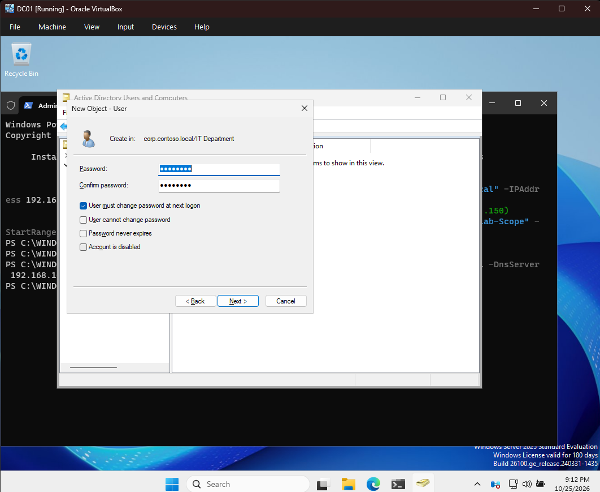
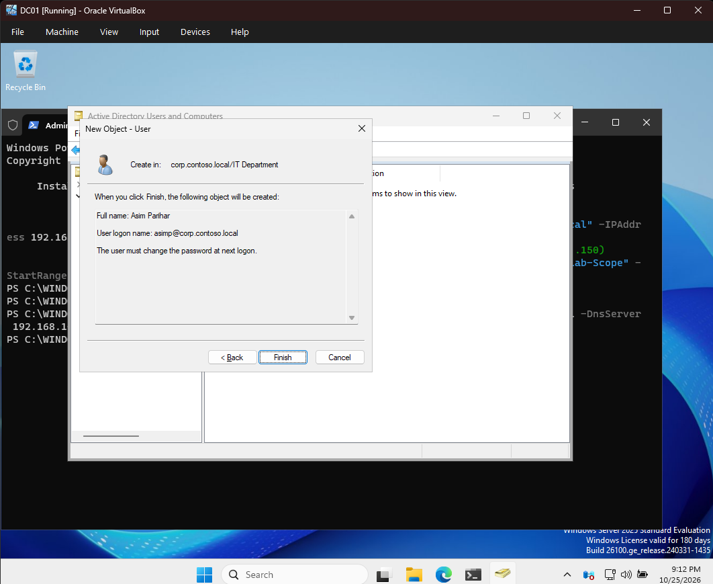
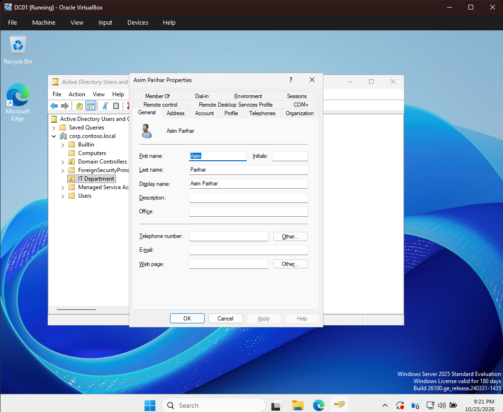

# Visual Evidence & Lab Screenshots

This directory contains verified screenshot evidence captured directly from the virtualized enterprise Active Directory lab environment (`corp.contoso.local`).

---

## Screenshot Inventory & Evidence Catalog

| Filename | Host / VM | Component / Role | Description |
| :--- | :--- | :--- | :--- |
| [`dc01-ad-user-creation-details.png`](dc01-ad-user-creation-details.png) | `DC01` | AD DS / ADUC | Active Directory Users and Computers — Account provisioning wizard for user `asimp` (`Asim Parihar`) in OU `IT Department`. |
| [`dc01-ad-user-creation-password.png`](dc01-ad-user-creation-password.png) | `DC01` | AD DS / ADUC | Initial credential setup enforcing "User must change password at next logon". |
| [`dc01-ad-user-creation-summary.png`](dc01-ad-user-creation-summary.png) | `DC01` | AD DS / ADUC | Summary verification dialog prior to user object commitment in Active Directory. |
| [`dc01-aduc-it-department-user.png`](dc01-aduc-it-department-user.png) | `DC01` | AD DS / ADUC | ADUC console displaying the provisioned user account within `OU=IT Department,DC=corp,DC=contoso,DC=local`. |
| [`dc01-aduc-user-properties.png`](dc01-aduc-user-properties.png) | `DC01` | AD DS / ADUC | Detailed Account Properties dialog for `Asim Parihar`. |
| [`dc01-dhcp-scope-address-pool.png`](dc01-dhcp-scope-address-pool.png) | `DC01` | DHCP Server | DHCP Management console showing active Address Pool: `192.168.10.50` to `192.168.10.150` on Scope `[192.168.10.0]`. |
| [`dc01-gpo-it-security-baseline.png`](dc01-gpo-it-security-baseline.png) | `DC01` | Group Policy (GPMC) | Group Policy Management Console showing `IT Security Baseline` GPO linked to domain `corp.contoso.local`. |
| [`dc01-aduc-computers-client01.png`](dc01-aduc-computers-client01.png) | `DC01` | AD DS / ADUC | ADUC console verifying computer account `CLIENT01` registered under `corp.contoso.local\Computers`. |
| [`client01-domain-join-properties.png`](client01-domain-join-properties.png) | `CLIENT01` | Windows 11 Client | System Properties confirming client workstation domain membership to `corp.contoso.local` (`CLIENT01.corp.contoso.local`). |
| [`client01-ipconfig-dhcp-lease.png`](client01-ipconfig-dhcp-lease.png) | `CLIENT01` | Networking / DHCP | `ipconfig /all` output verifying dynamic IP assignment (`192.168.10.50`), Default Gateway (`192.168.10.1`), DHCP Server (`192.168.10.10`), and DNS Server (`192.168.10.10`). |
| [`client01-dns-nslookup.png`](client01-dns-nslookup.png) | `CLIENT01` | DNS Resolution | `nslookup dc01.corp.contoso.local` verifying DNS query resolution to Primary Domain Controller (`192.168.10.10`). |
| [`client01-gpupdate-force.png`](client01-gpupdate-force.png) | `CLIENT01` | Group Policy Client | `gpupdate /force` terminal output demonstrating Group Policy application and user policy update success. |

---

## Visual Previews

### 1. Active Directory Identity & Account Management (`DC01`)

*Figure 1: ADUC Account Provisioning Wizard — User details for `asimp` in `IT Department`.*

*Figure 2: Password configuration with mandatory password reset at first logon.*

*Figure 3: User creation confirmation summary.*

*Figure 4: ADUC console displaying user object `Asim Parihar` in `IT Department` OU.*

*Figure 5: Active Directory user properties dialog.*

*Figure 6: ADUC Computers container verifying domain joined computer `CLIENT01`.*

---

### 2. Network Services: DHCP Scope & Dynamic Leasing (`DC01`)

*Figure 7: DHCP Management console displaying Scope `[192.168.10.0]` Address Pool (`192.168.10.50` - `192.168.10.150`).*

---

### 3. Group Policy Infrastructure (`DC01`)

*Figure 8: Group Policy Management Console showing `IT Security Baseline` GPO linked to domain `corp.contoso.local`.*

---

### 4. Client Workstation Domain Integration & Diagnostics (`CLIENT01`)

*Figure 9: System Properties on `CLIENT01` confirming domain membership to `corp.contoso.local`.*

*Figure 10: `ipconfig /all` output confirming IP lease `192.168.10.50`, Gateway `192.168.10.1`, and DNS `192.168.10.10`.*

*Figure 11: `nslookup dc01.corp.contoso.local` confirming internal DNS name resolution.*

*Figure 12: `gpupdate /force` verifying policy evaluation on `CLIENT01`.*
